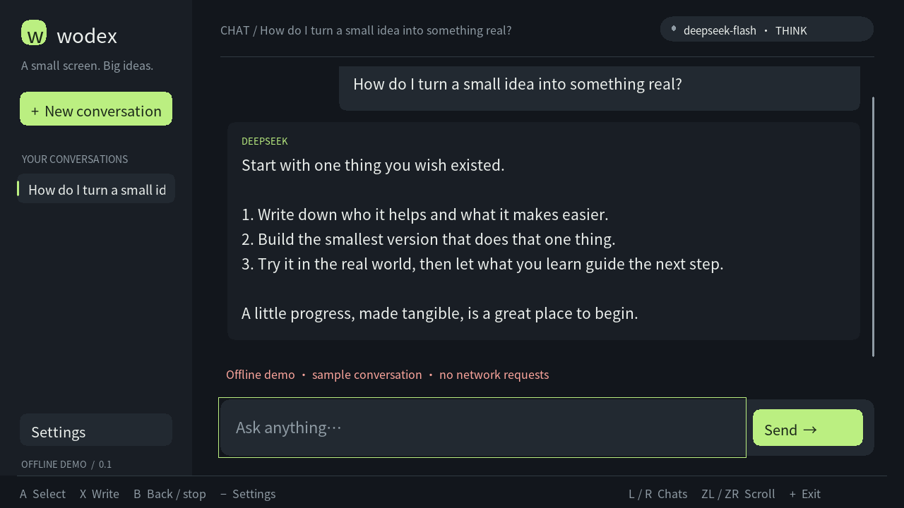

# Wodex

[](https://github.com/old-new-things/wodex/actions/workflows/build.yml)

A native DeepSeek chat client for Nintendo Switch homebrew, with a desktop build for development. Inspired by wiliwili's controller navigation and readable handheld interface.

The app streams Markdown replies, saves conversations, supports thinking mode, includes a Chinese-capable font, and uses the Switch system keyboard. It also checks the Versions and Nightly channels for updates and can replace its verified Switch NRO on exit. A real ARM64 `.nro` has been cross-compiled and linked. Physical Switch testing and a live request with your own DeepSeek key are still required.



## Use on Switch

1. Download `wodex.nro` from the [Nightly or Versions channel](https://old-new-things.github.io/wodex/). Copy it to `sdmc:/switch/wodex/wodex.nro`. Local builds produce `build/switch/wodex.nro`.
2. Launch hbmenu with full application memory through your homebrew environment. For a typical title-override setup, hold **R** while launching a game, then select Wodex.
3. Open **Settings**, enter your [DeepSeek API key](https://platform.deepseek.com/), and return to chat.
4. Press **X** to write, confirm the keyboard, then select **Send**.

DeepSeek runs remotely; the Switch is the chat client. Wodex connects directly to your configured provider. There is no application server to deploy.

| Control | Action |
| --- | --- |
| D-pad | Move focus |
| A | Select |
| B | Back; stop an active reply |
| X | Write a message |
| Y | Show/hide reasoning text |
| L / R | Previous/next saved conversation |
| ZL / ZR or right stick | Scroll |
| − | Settings |
| + | Save and exit |

Touch is supported. Settings provide a configurable model name, endpoint, thinking mode, response token limit, and assistant instructions. The default model is `deepseek-flash`, matching the [current DeepSeek API](https://api-docs.deepseek.com/). Change the model name in Settings when your provider changes its available models.

## Build and run on desktop

Requirements: Rust/Cargo, a C++17 compiler, CMake 3.20+, SDL2 **2.0.18+**, SDL2_ttf **2.0.18+**, libcurl **7.62+**, and Python 3 for integration tests. SDL2_ttf needs FreeType. Ninja is optional.

On Debian/Ubuntu:

```sh
sudo apt-get install build-essential cmake ninja-build pkg-config \
  libsdl2-dev libsdl2-ttf-dev libcurl4-openssl-dev fonts-dejavu-core
cmake -S . -B build/desktop -G Ninja -DCMAKE_BUILD_TYPE=Release
cmake --build build/desktop --parallel
./build/desktop/wodex
```

On macOS, install SDL2, SDL2_ttf, FreeType, CMake, and Ninja with your package manager. If SDL2_ttf is unavailable, `bash scripts/setup-desktop.sh` downloads its checksum-verified 2.24.0 source for the CMake fallback. For installations that CMake cannot discover, pass `-DCMAKE_PREFIX_PATH=/your/package/prefix` or `-DSDL2_DIR=/your/prefix/lib/cmake/SDL2`.

```sh
bash scripts/setup-desktop.sh  # only needed without system SDL2_ttf
cmake -S . -B build/desktop -G Ninja -DCMAKE_BUILD_TYPE=Release
cmake --build build/desktop --parallel
./build/desktop/wodex --demo
```

Desktop controls: arrows and Enter select; **X** opens the composer; **Ctrl/Cmd + Enter** sends; **Esc** goes back/stops; **F1** opens Settings; **[ / ]** changes chats; **Page Up/Down**, the mouse wheel, and **End** navigate history. The text editor supports UTF-8, IME input, cursor movement, selection of all text, paste, and Shift+Enter for newlines. Desktop gamepads use SDL's standard button mapping. Keep the generated `resources/` directory beside the desktop executable when moving it.

`--demo` displays an explicitly labeled sample conversation without network requests or saving history. `--screenshot FILE.bmp` renders one frame and exits; combine it with `SDL_VIDEODRIVER=dummy` for a headless preview.

| Environment variable | Purpose |
| --- | --- |
| `DEEPSEEK_API_KEY` | Desktop session key override; never writes that override to disk |
| `WODEX_DATA_DIR` | Desktop data directory override |
| `WODEX_FONT` | Desktop TrueType/OpenType font override; otherwise uses the bundled CJK font |
| `WODEX_CA_BUNDLE` | Desktop custom CA bundle for HTTPS verification |

## Build for Switch

Use the official devkitPro Switch SDK and Rust `nightly-2026-10-01` with `rust-src`:

```sh
rustup toolchain install nightly-2026-10-01 --profile minimal --component rust-src
export DEVKITPRO=/opt/devkitpro
bash scripts/build-switch.sh
```

Required SDK packages: `switch-dev`, `switch-sdl2`, `switch-sdl2_ttf`, `switch-curl`, and `switch-pkg-config`. Output: `build/switch/wodex.nro`.

The verified SDK image is `devkitpro/devkita64:20260219`. [Architecture and build details](docs/architecture.md) include the exact two-stage commands used to build the NRO on a host with Rust and a container engine. [GitHub Actions](https://github.com/old-new-things/wodex/actions/workflows/build.yml) checks Rust formatting, lints and tests, builds and tests the desktop client, builds the Switch NRO, and exercises update installation using that NRO.

Successful `main` builds publish timestamped nightlies to [GitHub Pages](https://old-new-things.github.io/wodex/), also scheduled daily at 00:17 UTC. Explicit `vX.Y.Z` tags publish fixed version downloads after the same checks. The site retains up to seven nightlies and ten versions, with public downloads, checksums and license notices; no GitHub login is needed. GitHub Releases are not used. Other branches and pull requests produce CI artifacts without publishing the site. A separate [publication workflow](https://github.com/old-new-things/wodex/actions/workflows/publish.yml) verifies the live downloads before reporting publication success.

## Data and behavior

- Switch data lives in `sdmc:/switch/wodex/state.json`. Desktop defaults to `~/Library/Application Support/Wodex/` on macOS or `$XDG_DATA_HOME/wodex/` / `~/.local/share/wodex/` on Linux.
- History and keys entered in Settings are stored **unencrypted** locally. Desktop directories/files use user-only permissions; an SD card does not provide that isolation. The environment key override is session-only.
- Storage is versioned and bounded. Writes preserve the previous save on interruption. Unreadable saves are copied to a unique `state.json.recovery-N` file before starting fresh; they are never silently overwritten.
- Interrupted replies retain their partial text and can be retried from Settings. Incomplete assistant replies and prior reasoning are omitted from subsequent API context. Sending is serialized so responses cannot cross between conversations.
- HTTPS certificates are verified, redirects are refused, and provider error bodies are not displayed. Plain HTTP is limited to loopback addresses for local tests.
- Limits: 32 conversations, 128 messages per conversation, 64 KiB per prompt, 512 KiB combined answer/reasoning, 2 MiB total message text, and 4 MiB saved JSON. Delete an older conversation when storage is full. Long answers remain fully scrollable.

Current scope is text chat. Markdown is displayed as readable text; tool execution, attachments, image generation, search, and account login are outside this release. Switch keyboard input follows libnx's size limits; a very long existing draft cannot be reopened without shortening it.

## Fonts and Chinese text

Wodex includes **Noto Sans CJK SC Regular 2.004**, an unmodified, openly licensed OpenType font. It supports broad Simplified Chinese, Traditional Chinese, Japanese, Korean and Latin text. Regional glyph shapes follow the Simplified Chinese variant; it does not contain every Unicode character or all emoji. Its license and provenance are included in `romfs/fonts/`.

The full 16,437,364-byte font is embedded in the Switch NRO's RomFS, so Chinese replies do not depend on the console's language or a separately installed font. A UI-text-only subset would miss characters in model replies. Desktop builds copy the same font into `resources/fonts/` beside the executable, and locate it independently of the working directory.

Inline and fenced code use **Source Code Pro Regular 2.042** for ASCII, with Noto Sans CJK for other characters. This unmodified 131,128-byte monospace font and its SIL Open Font License are also bundled. Wide characters occupy two code cells.

SDL_ttf/FreeType reads UTF-8 text using the font's stream API; Wodex does not manually copy the full file for every point size. Text layout and visible texture caches remain bounded. If the bundled font is absent at runtime, Switch falls back to its system-language shared font and desktop falls back to a system font. This is a whole-font fallback, not a per-character fallback chain. `WODEX_FONT` overrides the desktop choice, so that font needs the glyph coverage you want.

## Markdown replies

Assistant replies and thinking text render headings, bold/italic/strikethrough, lists and task markers, quotes, links, inline and fenced code, and tables. Streaming replies update their formatting as text arrives. Code preserves indentation and wraps long lines; wide tables become labeled rows to fit the handheld display.

The Rust renderer uses the bundled CJK font and stays `no_std`. Links show their destinations and images show alternative text; neither triggers network requests. User messages, the composer, saved history, and API requests preserve their original text. [Markdown support and limits](docs/markdown.md) includes reproducible visual fixtures. Markdown is available in current nightlies.

## Self-updates

Open **Settings → Updates**, choose **Versions** or opt into **Nightly**, then choose **Check for updates**, **Download**, and **Install and exit**. New installations use the official `old-new-things/wodex` Pages source and Versions channel. Existing empty sources stay disabled; **Use Wodex** selects the official source. Checks are manual. Desktop builds can check both feeds; self-installation is supported on Switch.

Nightlies are ordered by their UTC build timestamps, independently of version numbers. From an installed nightly, choosing Versions offers the latest published version even when its version number is lower. An installed Versions build still selects only newer versions. These rules are available in current nightlies; the fixed 0.2.1 download retains its original comparison rules.

If you installed the early nightly labeled 0.3.0, [install a current nightly manually once](docs/updates.md#install-an-update) to receive the new comparison rules. Existing 0.2.0 installations can update to 0.2.1 through Versions, then select Nightly.

Wodex downloads the selected build's `wodex.nro` to a sibling temporary file and verifies the feed's advertised size, SHA-256, executable headers and embedded assets. Installing saves conversations, closes the interface and embedded resources, preserves a launchable `.previous.nro`, and replaces the actual NRO path supplied by the loader. Reopen Wodex from hbmenu afterward. A normal exit never installs a downloaded update.

The SD-card replacement uses two renames, so power interruption can require restoring the `.previous.nro` backup manually. [Update and recovery instructions](docs/updates.md) explain that boundary, both build channels, and publication recovery.

## Verify

```sh
cargo fmt --all -- --check
cargo clippy --workspace --all-targets --locked -- -D warnings
cargo test --workspace --locked
python3 -m unittest discover -s tests -p 'test_*pages*.py'
cmake --build build/desktop --parallel
ctest --test-dir build/desktop --output-on-failure
```

The integration tests start isolated loopback mock servers. They drive the Rust application through SDL input and the Rust network backend's real curl bindings, and test fragmented UTF-8 streams, reasoning, usage, retry, HTTP errors, cancellation, queue limits, and durable storage. Update tests exercise the Rust updater's downloads, checksums, Pages source restrictions, cancellation, backup preservation and rollback failures. Rust fault-injection tests cover short/interrupted writes, failed flushes, save rotation and rollback. Markdown tests cover parsing, streaming fragments, style-aware wrapping, tables, code indentation, bounded caches and long-message fallback. Font tests exercise the production Rust renderer with real styled Chinese and mixed-language fonts; UI smoke tests render chat and update pages. Publication tests cover artifact integrity, immutable versions, retention, archive extraction and deployment-state recovery. No tests require a real API key or spend API credits.

## Source map

- `core/src/app/`: Rust views, editor, text layout/cache, platform interfaces, and tests.
- `core/src/app.rs`: Rust application actions, navigation, chat/update coordination, and saving.
- `core/src/backend/`: Rust HTTP policy, workers, streaming queues, durable storage, font selection, updater, installation and rollback.
- `core/src/`: conversation state, validation, persistence model, SSE parser, version-feed validation, and C ABI.
- `native/`: SDL/TTF, libnx, POSIX filesystem, curl and thread/mutex bindings, input normalization, and process lifecycle.
- `scripts/`: desktop dependency fallback and Switch build.
- `tools/publish-pages/`: host-only Rust publisher for the static download page and update feed.
- `tests/`: integration suites, local mock APIs, and test-only C++ facades that call the production Rust backends.
- `romfs/`: bundled CJK font, license/attribution, and public CA certificates.

Wodex code is licensed under [WTFPL version 2](LICENSE). Dependencies retain their own licenses, listed in [THIRD_PARTY.md](THIRD_PARTY.md). Previously published downloads retain their accompanying license files.
